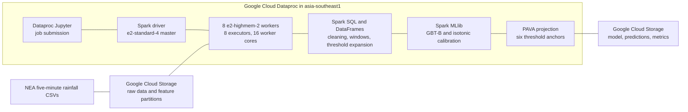
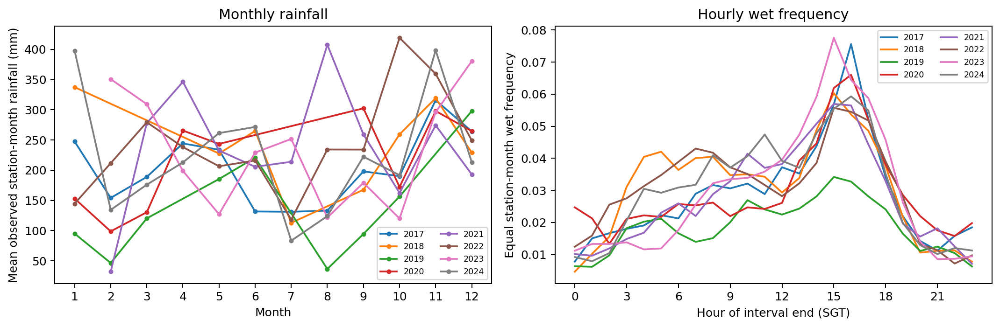
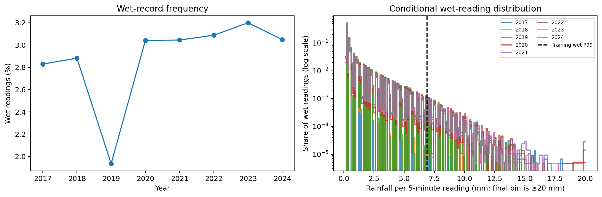
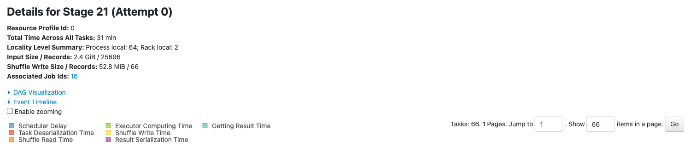
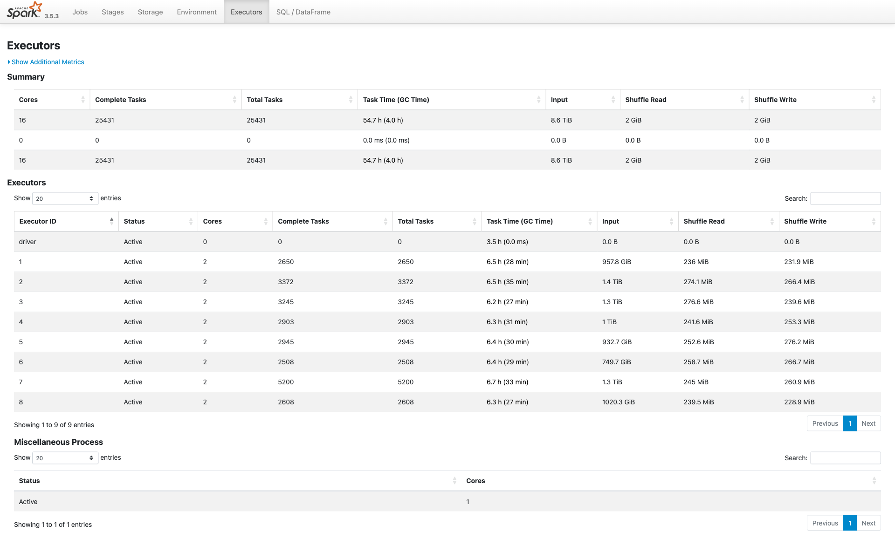

# Singapore Rainfall Analysis and Prediction

This project provides a reproducible distributed analytics and rainfall
modeling pipeline for National Environment Agency five-minute observations
across Singapore. It has two practical stages: analyzing historical rainfall
patterns and training models on historical observations to estimate whether
the next 30-minute accumulated rainfall will exceed a requested threshold.
Spark builds the features, and Spark MLlib develops the prediction models.

<p align="center">
  <strong>Apache Spark 3.5.3</strong> | <strong>Google Cloud Dataproc</strong> |
  <strong>PySpark MLlib</strong> | <strong>Python 3.11</strong>
</p>

## Results snapshot

The results below come from run `20261016-v2-fixed8-04`. Model quality is
reported on the held-out 2024 period, which contains 6,374,476 valid base
windows. At the 0.5 mm threshold, the final calibrated GBT-B pipeline improves
discrimination and Brier score over the training-only climatology baseline.

| Held-out 2024 metric at 0.5 mm | Final GBT-B + calibration + PAVA | Training-only climatology |
|---|---:|---:|
| PR-AUC (Spark, 1,000 bins) | **0.6345** | 0.0732 |
| Brier score | **0.01958** | 0.03436 |
| Weighted calibration ECE | 0.001670 | **0.001425** |

At a fixed probability cutoff of 0.5, final precision was 74.2% and recall was
52.7%. Climatology had slightly lower weighted ECE, so the model's gains are in
discrimination and Brier error, not every metric. The final PAVA projection
removed all threshold-order violations across 31,872,380 adjacent prediction
pairs.

| Distributed workload | Scale and recorded execution |
|---|---|
| Final GBT-B fit | 34,541,470 base training windows expanded to 207,248,820 threshold rows; 241 Spark jobs, 404 stages, 25,431 tasks; 12,286.9 seconds |
| 2024 evaluation | 6,374,476 base windows expanded to 38,246,856 threshold rows; 325 Spark jobs, 25,305 tasks; 478 seconds |

The final fit ran on Google Cloud Dataproc in `asia-southeast1` with eight
`e2-highmem-2` workers, eight two-core Spark executors, and 16 worker cores.
Spark event logs recorded 8.6 TiB of input, about 2 GiB each of shuffle reads
and writes, and no task memory or disk spill. The workload used 256 shuffle
partitions, Adaptive Query Execution, and `DISK_ONLY` persistence for reused
DataFrames. These are saved run results, not a statement about current cloud
resources.

## Distributed architecture



## Historical rainfall analysis

<table>
  <tr>
    <th>Historical rainfall patterns by month and hour</th>
    <th>Wet-reading frequency and intensity</th>
  </tr>
  <tr>
    <td>
      
    </td>
    <td>
      
    </td>
  </tr>
  <tr>
    <td><sub>Monthly totals and hourly wet frequency are averaged across eligible stations. Hour labels use the interval-end time in Singapore time.</sub></td>
    <td><sub>The dashed line is the wet-reading 99th percentile estimated from 2017-2022 training observations.</sub></td>
  </tr>
</table>

## Spark execution evidence

The Spark History Server screenshots below are archived evidence from the
final GBT-B application, not a live cloud dashboard.

<table>
  <tr>
    <th>Stage 21 task and shuffle details</th>
    <th>Executor utilization</th>
  </tr>
  <tr>
    <td>
      <a href="report/figures/final/spark_ui_final_stage.png">
        
      </a>
    </td>
    <td>
      <a href="report/figures/final/spark_ui_final_executors.png">
        
      </a>
    </td>
  </tr>
  <tr>
    <td><sub>Stage 21 processed 2.4 GiB in 66 tasks and wrote 52.8 MiB of shuffle data across eight executors.</sub></td>
    <td><sub>Eight two-core worker executors completed 25,431 tasks. Application totals recorded 8.6 TiB of input and about 2 GiB each of shuffle read and write.</sub></td>
  </tr>
</table>

## Model training on historical rainfall data

| Years | Role |
|---|---|
| 2017-2020 | Deterministic 10% hyperparameter screen; refit candidates on valid rows |
| 2021 | Hyperparameter validation |
| 2022 | Model and feature selection on a deterministic 10% sample |
| 2017-2022 | Refit the selected model on all valid windows |
| 2023 | Fit isotonic calibration on a deterministic 10% sample |
| 2024 | Final evaluation period |

Each prediction target sums the six exact five-minute observations after the
prediction time. Windows that cross a temporal split boundary are excluded.
Notebook 03 compares model and feature candidates using historical data.
Notebook 04 refits the selected model on all valid 2017-2022 rows, calibrates
probabilities on 2023, then evaluates on the held-out 2024 period. The
prediction step applies equal-weight PAVA to the six anchor thresholds and
linearly interpolates between them for in-domain queries. Climatology
probabilities are estimated from training data only.

Hyperparameter screening uses a deterministic 10% sample from 2017-2020, with
surviving configurations refit on that period's valid rows. Hyperparameter
validation uses 2021; model/feature selection and calibration use deterministic
10% samples of their respective partitions.

During final evaluation, a PySpark expression error in the PAVA
post-processing step was corrected, and the affected post-processing metrics
were recomputed from the saved model predictions; model fitting and calibration
were unchanged.

## Repository layout

| Path | Purpose |
|---|---|
| `config/experiment.json` | Split periods, thresholds, features, and model grids |
| `manifests/input_manifest.json` | Eight 2017-2024 inputs, schemas, row counts, and hashes |
| `notebooks/00_setup_cloud.ipynb` | Local input preflight, GCS upload, and Dataproc setup |
| `notebooks/01_clean_and_task1.ipynb` | Historical data cleaning, coverage checks, and rainfall analysis |
| `notebooks/02_build_features.ipynb` | History features, target windows, and purged temporal splits |
| `notebooks/03_model_development.ipynb` | Historical-data model comparison and selection |
| `notebooks/04_final_fit_evaluate.ipynb` | Full historical-data training, 2023 calibration, PAVA, and 2024 evaluation |
| `scripts/rainfall_modeling.py` | Shared Spark ML, metrics, climatology, PAVA, and interpolation functions |
| `scripts/build_manifest.py` | Reusable input inventory and validation functions |
| `scripts/run_notebooks_sequentially.py` | Sequential Dataproc runner for Notebooks 03 and 04 |

## Data

Download the annual **Historical Rainfall across Singapore** CSV files for
2017-2024 from the [data.gov.sg collection](https://data.gov.sg/collections/2279/view).
Keep the raw files outside this repository. Set `DATA_ROOT` to a directory
containing a `raw/` folder with the eight manifest-listed files. Raw CSVs are
not tracked in Git or included in the release artifacts.

The manifest records file inventory, schema, timestamp ranges, row counts, and
SHA-256 digests. It validates the input snapshot but does not certify the
semantic quality of observations. Do not use 2016 as warm-up data.

## Environment

The setup notebook runs locally. Analysis notebooks run in Dataproc Jupyter
with the configured Spark environment; there is no local Spark execution path.
Install Python and the Google Cloud CLI, then authenticate an account with
access to the configured project and bucket:

```bash
gcloud auth login
python3 -m venv .venv
source .venv/bin/activate
python -m pip install --upgrade pip
python -m pip install -r requirements-local.txt ipykernel
python -m ipykernel install --user \
  --name singapore-rainfall \
  --display-name "Python (Singapore Rainfall)"
```

Place the eight CSVs under `$DATA_ROOT/raw/`, then set `DATA_ROOT`,
`GOOGLE_CLOUD_PROJECT`, `BILLING_ACCOUNT_ID`, `BUCKET`, and a new `RUN_ID` in
the local environment before running `00_setup_cloud.ipynb`. Account and
project identifiers are read from the environment rather than stored in the
notebook. Review the region, bucket, quota, and provisioning settings before
running its cloud setup cells. The notebook uploads the analysis notebooks,
shared modeling helper, and experiment configuration. It copies the saved
feature partitions named by `base_features_source_run_id` in the config.

The analysis notebooks use Dataproc image `2.2.87-debian12` with bundled
Python 3.11 and Spark 3.5.3. Do not install or upgrade PySpark on that image.

## Run the pipeline

Keep `BUCKET` consistent. Notebook 00 creates the target run and copies the
feature partitions named by `base_features_source_run_id` in the experiment
config. Notebook 03 and Notebook 04 use the target run ID.

1. Run `00_setup_cloud.ipynb` locally to upload inputs and source files,
   create or check the Dataproc cluster, and copy the saved feature partitions
   into the target run.
2. `03_model_development.ipynb` uses only `search_train`, `hp_validation`, and
   `model_selection`. It writes the selected model specification after
   candidate comparison.
3. `04_final_fit_evaluate.ipynb` reads the selected model configuration,
   refits on all valid 2017-2022 data, fits the calibrator on 2023, and
   evaluates the 2024 period.

On the Dataproc master, the same two stages can run sequentially with
`RUN_ID=<target-run-id> python scripts/run_notebooks_sequentially.py`. Start an
existing STOPPED cluster before launching Spark jobs.

Notebooks 01 and 02 clean the raw inputs and build the saved feature
partitions. Run them when those partitions need to be regenerated.

Run outputs are stored under
`gs://<BUCKET>/runs/<RUN_ID>/`. Final scores include raw, calibrated, and
PAVA-projected probabilities at the anchor thresholds. Unseen in-domain
thresholds are answered by linear interpolation; out-of-domain queries fail.

## Operations and artifacts

After confirming that notebooks, metrics, model artifacts, and manifests are
persisted, delete the run's Dataproc cluster and verify that no compute
resources remain. Review the remaining storage objects before retention or
cleanup decisions.

The report documents the historical analysis and measured model-evaluation
results. For a new run, refresh it after `final_evaluation_summary.json` is
written, then compile and visually review the PDF before packaging the source,
trained model, and report together.
